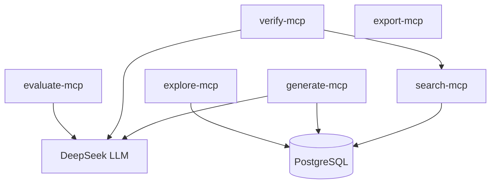

# Graceful Degradation Matrix

Documents every failure mode across all 6 MCP services and the expected
degraded behavior.  Saimon follows a **fail-closed** philosophy:
no API key → error; LLM down → degraded response; DB down → health fails.

## Failure Mode Matrix

| Failure | Search MCP | Generate MCP | Verify MCP | Explore MCP | Evaluate MCP | Export MCP |
|---------|-----------|-------------|-----------|------------|-------------|-----------|
| **LLM down** | N/A (no LLM) | `status: degraded` with fallback content | `status: degraded` with heuristic verification | N/A (no LLM) | `status: degraded` with heuristic scores | N/A (no LLM) |
| **DB down** | `/health` fails; tools return fallback placeholders | `/health` fails; `/tools/generate_content` still works (LLM only) | N/A (no DB req.) | `/health` fails; tools return fallback placeholders | N/A (no DB req.) | N/A (stateless) |
| **Shadow library down** | `search_knowledge_graph` still works; `search_shadow_libraries` returns degraded | N/A | `verify_claim` works without shadow corroboration | N/A | N/A | N/A |
| **Single MCP down** | Others unaffected — no inter-MCP calls | Others unaffected | Others unaffected | Others unaffected | Others unaffected | Others unaffected |
| **No API key** | All tools return 401 | All tools return 401 | All tools return 401 | All tools return 401 | All tools return 401 | All tools return 401 |
| **Rate limit exceeded** | All tools return 429 with Retry-After | Same | Same | Same | Same | Same |
| **Payload too large** | Returns 413 | Returns 413 | Returns 413 | Returns 413 | Returns 413 | Returns 413 |
| **Invalid content_type** | Validated against whitelist → 422 | Same | N/A | Same | N/A | N/A |

## Service Dependencies



## Inter-MCP Communication

- **verify-mcp** → **search-mcp**: calls `search_shadow_libraries` for source
  corroboration.  If search-mcp is down, verify-mcp degrades to heuristic-only
  verification (no shadow sources).
- No other MCP calls another MCP directly.

## Health Check Responses

Each MCP exposes `/health` (unauthenticated):

```json
{
  "status": "ok",
  "service": "search-mcp",
  "checks": {
    "database": "connected|unavailable",
    "llm": "connected|unavailable"
  }
}
```

- `status: ok` means the MCP process is alive (always returns 200).
- Individual `checks` indicate backend connectivity.
- A `503 Service Unavailable` would indicate the MCP process itself cannot start
  (e.g., missing required secrets).

## Audit Trail

Every tool call writes to `audit_log` with:
- `trace_id` — request UUID
- `service_name` — which MCP
- `event_type` — "request" or "response"
- `payload` — full JSON record with `caller_key_hash` (hashed API key)
- Tool name and parameters

Query via `saimon_list_audit_log` tool (search-mcp).
