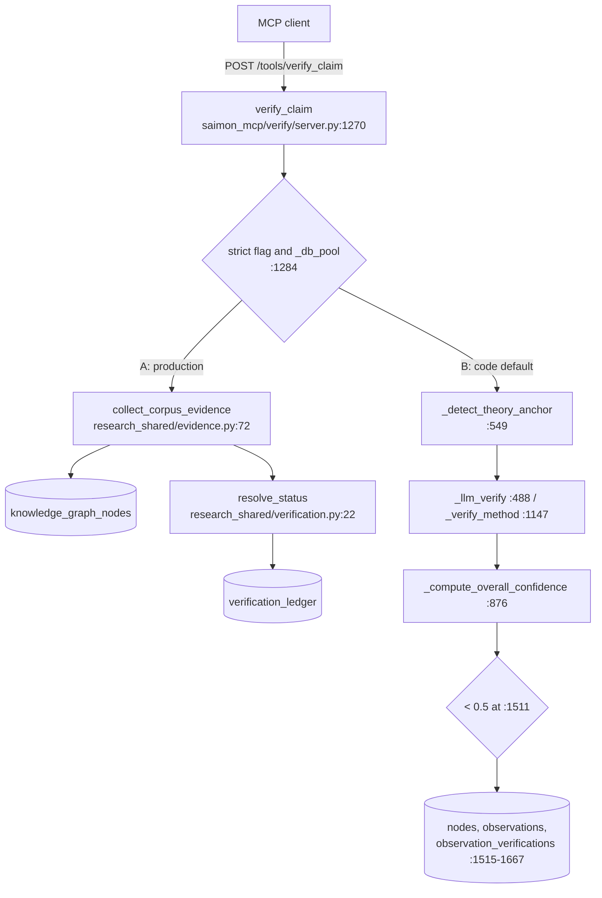
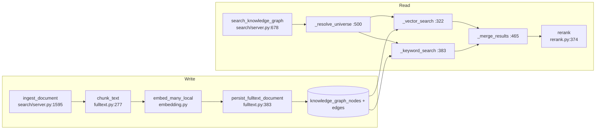

<!--
Published as the evidence annex to the Saimon case study.
Citations use file:line against commit b0ae0ba (2026-11-13). The public-tree
cleanup that followed (#335, #338) renamed modules and deleted internal planning
docs, so a line number may no longer resolve on main; check out b0ae0ba to verify,
or read the symbol name, which is stable.
-->
# Saimon: architecture breakdown

> **Read this first.** This breakdown is a point-in-time audit of commit `b0ae0ba`
> (2026-11-13). A cleanup landed immediately afterwards and is not reflected in the
> text below: `shadow_registry` became `archive_registry`, the verification method
> `shadow_source_corroboration` became `doi_cache_corroboration`, the request
> parameter `use_shadow_sources` became `use_archive_sources`, verify's call to the
> removed `/tools/search_shadow_libraries` route now targets `/tools/search_archives`,
> the internal planning documents were deleted, and the four scraper seed rows were
> removed from `sources`. The findings the document reports — the production verifier
> is lexical, `contradicted` is unreachable, verdicts vary between runs, `universe` is
> ignored by `verify_claim` — were true at `b0ae0ba` and each still stands unless a
> later commit says otherwise.

`Scope: all nine services · Version: b0ae0ba · Audience: a technical hiring manager reading a product portfolio · Generated: 2026-11-13 · Unverified items: 30 (UNVERIFIED 3 · INFERRED 19 · NOT MEASURED 5 · CONFLICT 3)`

Every citation refers to commit `b0ae0ba` (main, merge of PR #334, 2026-11-13). Live figures come from the running stack on my production host, whose image label records the same revision (`docker inspect saimon-verify` → `org.opencontainers.image.revision=b0ae0baa…`). Where this document disagrees with the evidence pack I was given, I went with the code, and section 7 lists each disagreement.

## 0. Summary

Saimon is my personal research knowledge base, built for me and the agents I run; it has no customers. I built it to refuse two things: answering outside the caller's universe on the search path (`saimon_mcp/search/server.py::_resolve_universe`), and calling a claim supported when no stored passage backs it (`research_shared/verification.py::resolve_status`). It runs as nine HTTP services (`docker-compose.yml:44–268`) over one PostgreSQL 16 + pgvector database (`docker-compose.yml:12`) that holds 11,495 graph nodes and 14,306 edges (query, 2026-11-13T07:16Z). The main finding of this pass: in production, `verify_claim` does not run the five-method weighted verifier. It runs a lexical evidence check, and it ignores the `universe` parameter (`docker-compose.prod.yml:172`, `saimon_mcp/verify/server.py:1284`). The five methods and the 0.5 abstain threshold run only when that flag is off. No latency has been measured. This document carries 3 `UNVERIFIED` items.

## 1. End-to-end request

Request: `POST /tools/verify_claim` with `parameters = {"claim": "pgvector HNSW supports cosine distance", "universe": "reality"}`.

I did not send the request. Every call on the deployed path inserts a row into `verification_ledger` (`saimon_mcp/verify/server.py:1318–1335`), and this pass was read-only. I reproduced its one database read with the same SQL instead (step 4A).

The handler forks at step 3. Branch A is what production runs (`SAIMON_VERIFY_STRICT_EVIDENCE: "1"`, `docker-compose.prod.yml:172`; the running container's env shows `=1`). Branch B is what the code does by default (`saimon_mcp/verify/server.py:247–253`, default `"0"`).

| # | Service / module (path) | Function entry point | Tables read | Tables written | Why this step exists | Failure behaviour |
|---|---|---|---|---|---|---|
| 1 | verify-mcp, `saimon_mcp/verify/server.py` | `verify_claim` (`:1270`), `_require_auth` (`:1274`) | — | — | One service owns verdicts | Bad key → HTTP 401 (`:85–87`). Missing `claim` → `status: "error"` (`:1277–1278`) |
| 2 | same | parameter read (`:1276`, `:1362`, `:1398`, `:1429`, `:1483`, `:1491`) | — | — | — | `universe` is never read. The only `universe` handling in this file is in `verify_against_kg` (`:230–234`). The request's `reality` is dropped without any error |
| 3 | same | gate `_strict_evidence_enabled() and _db_pool is not None` (`:1284`) | — | — | Lets the operator switch verdict models | If the pool is absent, Branch B runs silently (see the outage row below) |
| 4A | `research_shared/evidence.py` | `collect_corpus_evidence` (`:72–110`), `EVIDENCE_SQL` (`:61–68`) | `knowledge_graph_nodes` | — | Retrieval: `ILIKE ANY` over title/body for up to six claim tokens of ≥4 chars, content types `fulltext_document`/`fulltext_chunk`/`claim`, `LIMIT 40` with no `ORDER BY`. No embedding, no universe predicate, no `user_id` predicate | Keeps a row only if ≥2 tokens match (`:24`) and the quote is ≥60 chars (`:25`). Returns at most 5 (`:26`). Every item gets `polarity: "supports"` (`:105`) |
| 5A | `research_shared/verification.py` | `resolve_status` (`:22–55`) | — | — | Verdict as a function of evidence counts | No evidence → `insufficient_evidence`, confidence 0.0. Otherwise confidence `min(0.6+0.05n, 0.95)` (`saimon_mcp/verify/server.py:1289`), floored at 0.65 (`research_shared/verification.py:16`). No 0.5 comparison on this branch |
| 6A | `saimon_mcp/verify/server.py` | ledger insert (`:1318–1335`) | — | `verification_ledger` | An audit trail for every verdict | If the insert fails, the verdict is still returned with `ledger_recorded: false` and `ledger_error` (`:1334–1335`) |
| 7A | same | `_ok` (`:256–266`), return (`:1356–1360`) | — | — | Response envelope | — |
| 3B | same | `_detect_theory_anchor` (`:549–577`) | — | — | Short-circuit for seeded sources and DOIs | Matches an in-memory seed list (`:25`, `:530–546`). **`[INFERRED]`** This claim contains no DOI or seeded title, so it resolves to `full_text` (matching is by DOI or normalised title substring, `:540–545`) |
| 4B | same → search-mcp | `_search_sources_with_status` (`:377–451`) | — | — | Outside sources | Runs only when `use_shadow_sources` is set or the claim contains a DOI (`:1406`). Not called for this request. It posts to `/tools/search_shadow_libraries` (`:403`), a route search-mcp no longer serves (section 5c) |
| 5B | same | `_llm_verify` (`:488–502`) or `_verify_method` (`:1147–1230`) | — | — | The "methods" | With an LLM, all method names go into **one** prompt and one model call (`:493–500`). Without one, or on `LLMError`/JSON error, every method is a stub returning `inconclusive` at 0.25 (`:1473–1480`) |
| 6B | same | `_compute_overall_verdict` (`:1233–1263`), `_compute_overall_confidence` (`:876–892`) | — | — | Weights are combined here | Reliability-weighted mean over the methods that were returned. An unknown method gets weight 0.5 (`:886`) |
| 7B | same | `abstained = overall_confidence < 0.5` (`:1511`) | — | — | Abstain decision | Strict `<`, an inline literal: not config, not a table. A score of exactly 0.5 does not abstain |
| 8B | same | KG write (`:1515–1667`) | `knowledge_graph_nodes`, `observations` | `knowledge_graph_nodes`, `observations`, `observation_verifications`, `observation_relations`, `observation_verification_evidence` | Persist the verdict as graph content | The only embedding on either branch happens here (`embed_node_text`, `:1543`). The whole block is wrapped in `except Exception: pass` (`:1666–1667`). Branch B writes nothing to `verification_ledger` |
| 9B | same | response (`:1686–1713`) | — | — | — | — |

Services touched: verify-mcp only, plus Postgres. search-mcp is touched only on Branch B with a DOI or `use_shadow_sources`, which this request has neither of. Not touched: generate, export, evaluate, explore, api, domain, crew.

What the caller receives on the deployed path:

| Case | `status` | Fields |
|---|---|---|
| Supported | `"success"` | `data.overall_verdict: "supported"`, `overall_confidence` ≥ 0.65, `counts {evidence, supporting, contradicting: 0, abstained: 0}`, `evidence[]` with `quote`, `citations[]` with `locator` or `locator_reason`, `ledger_recorded`, `methods_used: 1` (`saimon_mcp/verify/server.py:1294–1360`, `research_shared/verification.py:58–73`) |
| Abstention | `"success"` | `overall_verdict: "insufficient_evidence"`, `overall_confidence: 0.0`, `counts.abstained: 1`. This branch has no top-level `abstained` key; that key exists only on Branch B (`saimon_mcp/verify/server.py:1693–1694`) |
| DB outage, pool never created | `"success"` | The gate fails, so Branch B runs. With an LLM it returns a model verdict. Without one it returns `inconclusive` + `abstained: true`. Nothing in the payload says the database is missing (`:1284`, `:1518`) |
| DB outage, pool exists but the query fails | — | **`[INFERRED]`** HTTP 500 with no envelope. `db.fetch` in `research_shared/evidence.py:85` is not caught, and no exception handler is registered anywhere (`grep -rn exception_handler research_shared saimon_mcp` returns nothing) |

So an outage can be confused with an answer. In the first outage case it looks like a normal verdict. In the second it is at least an error rather than an abstention. No test covers either case for verify. The nearest test is search's `tests/saimon_mcp/test_integration/test_search_integration.py::test_search_knowledge_graph_degraded_without_db`, which accepts `status in ("success", "degraded")` and asserts `"unavailable"` in `data.reason`.

**`[INFERRED]`** For this claim, Branch A would return `supported`. My read-only run of `EVIDENCE_SQL` (2026-11-13T07:23Z) matched 267 rows; the first 40 included `pgvector README — index types, operators, and tuning` chunks containing 3–4 of the 5 tokens.

In prose: the claim reaches verify-mcp and passes the key check. Its universe is dropped. Production then runs a substring search over chunk and claim nodes, keeps passages sharing at least two distinctive words, and turns the count into a verdict and a confidence. It appends the result to the ledger and returns it. The weighted five-method path, the only place the 0.5 abstain exists, runs only when the strict flag is off.

## 2. Component rationale

| Component | Problem it solves (stated as the failure it prevents) | Alternative rejected | Why rejected (evidence) | Trade-off accepted | Citation |
|---|---|---|---|---|---|
| One MCP service per capability (9) | **`[INFERRED]`** An optional dependency or LLM failure in one capability taking every tool offline. crew needs `requirements-crew.txt`, which the base image does not install | One monolithic MCP server | NO RECORDED ALTERNATIVE | Nine containers, nine DB roles (`docker-compose.yml:18–26`), cross-service keys (`saimon_mcp/verify/server.py::_search_api_key`). A route rename in one service broke a caller in another without any failure surfacing (section 5c) | `docker-compose.yml:44–268` |
| One shared Postgres | **`[INFERRED]`** Verify reading a stale copy of chunks that search wrote. Here they read the same rows (`research_shared/evidence.py:61–68` reads what `research_shared/fulltext.py::persist_fulltext_document` writes) | One database per service | NO RECORDED ALTERNATIVE. The decision is stated, not argued: "Single node by design" (`README.md:126–127`) | A single point of failure for all nine services | `docker-compose.yml:12` |
| pgvector, not a separate vector store | **`[INFERRED]`** Vectors outliving their graph rows. Re-ingest deletes chunks, their edges and derived claims in one database (`research_shared/fulltext.py:428–455`) | Qdrant or a similar separate store | NO RECORDED ALTERNATIVE | Filtered vector recall depends on HNSW search depth, which is left at its default (`SHOW hnsw.ef_search` → 40). No index tuning at all (`schema.sql:83–84`) | `schema.sql:73`, `:83–84` |
| Graph: nodes + typed edges | **`[INFERRED]`** A chunk losing its parent document. Every chunk gets a `part_of` edge (`research_shared/fulltext.py:508–515`); live, there are 2,284 `part_of` edges for 2,284 chunks (query, 07:16Z) | A flat chunk table with a document FK | NO RECORDED ALTERNATIVE | `relation_type` is unconstrained `TEXT` (`schema.sql:93`). The claim→chunk link lives in JSON (`metadata->>'source_chunk_id'`), not an FK, and the code comment records 219 orphaned claims from that (`research_shared/fulltext.py:431–434`) | `schema.sql:89–98` |
| Typed content pipeline | A node with an unregistered type entering the store. `knowledge_graph_nodes.content_type` is an FK to `content_type_registry(name)` (`schema.sql:68`); 23 rows live | **`[INFERRED]`** A hard-coded enum, which is what a runtime insert avoids (`research_shared/fulltext.py:355–375`) | NO RECORDED ALTERNATIVE | Types are added by service code at runtime, so the registry contents depend on which services have run | `schema.sql:13–24` |
| Five-method weighted verification | **`[INFERRED]`** A single unweighted judgement deciding a verdict | A single verifier | In practice it is one: all methods go into one LLM prompt (`saimon_mcp/verify/server.py:493–500`) | One failed model call drops every method to a 0.25 stub (`:1473–1476`) | `saimon_mcp/verify/server.py:94–131` |
| Abstain below 0.5 | A low-confidence verdict returned as `supported` | **`[INFERRED]`** No abstention | NO RECORDED ALTERNATIVE | With no LLM, every claim abstains (stubs score 0.25), so coverage falls to zero (`tests/saimon_mcp/test_verify/test_server.py::test_stub_no_llm_abstains`) | `saimon_mcp/verify/server.py:1511` |
| Evidence-first verifier (production) | A "self-graded supported": a verdict with no stored evidence (`saimon_mcp/verify/server.py:1281–1282`) | The five-method LLM path | Recorded: commit `e618d9c` "ops(verify): enable strict evidence verdicts in production (#239)" | Lexical only. No universe scope. `contradicted` cannot be produced (`research_shared/evidence.py:105`): the live ledger holds 0 contradicted rows out of 9,000 (query, 07:16Z) | `research_shared/evidence.py`, `research_shared/verification.py` |
| Universes | Fiction appearing in research answers (`saimon_mcp/search/server.py:503–504`) | Gating on `collection` | Recorded: "`collection` is a provenance label and must never gate visibility" (`schema.sql:192`) | Rows written without `universe_id` cannot be reached by scoped search. 426 such nodes exist (section 5c) | `schema.sql:197–241`; commit `0ad0e9d` |
| CI eval gate + golden baseline | **`[INFERRED]`** A retrieval or verification regression merging without notice | No gate | NO RECORDED ALTERNATIVE | Developer time spent refreshing the baseline (3 refresh commits on `reports/golden-baseline.json`). The gate is weaker than its name (section 3) | `.github/workflows/ci.yml:61–83` |

## 3. Design goals and verification

Test count. Command: `docker run --rm -v /path/to/saimon:/src:ro -w /src <image b0ae0ba> sh -c "pip install pytest pytest-asyncio; python -m pytest --collect-only -q"`. Output: `1974 tests collected in 3.01s` (Python 3.11.15, `requirements.txt`, no crew extras). With `CI=true`, matching `.github/workflows/ci.yml:51`: `1874 passed, 69 skipped` and 0 failed, 2026-11-13T07:20Z. Without `CI`, 39 tests fail: 34 in `tests/test_pipeline.py` and 5 in `tests/saimon_mcp/test_integration/test_shadow_search_integration.py`. Both need live services or network access (`research_shared/pytest_hooks.py:24`). **`[CONFLICT]`** The asserted figure is "roughly 1,900". The evidence pack gives 1,955 collected and 1,890 passed on Python 3.14. I collect 1,974 on 3.11. The difference is probably the environment, but I have not reconciled it. I could not map all tests to goals; the table names the tests I read.

| ID | Goal (falsifiable statement) | How it is verified today | Verification type | Last known result + date | Gap |
|---|---|---|---|---|---|
| G1 | On Branch B, a response with `overall_confidence < 0.5` never has `overall_verdict: "supported"` | `tests/saimon_mcp/test_verify/test_server.py::test_low_confidence_abstains` (asserts only that the helper returns < 0.5); `::test_stub_no_llm_abstains` (endpoint returns `inconclusive` with no LLM) | unit | pass, 2026-11-13 | No boundary test at exactly 0.5. The production branch has no such threshold |
| G1b | On Branch A, a claim with no passage sharing ≥2 tokens returns `insufficient_evidence` | `tests/shared/test_verify_evidence.py::test_no_evidence_is_insufficient`, `::test_one_shared_word_is_not_evidence` | unit (helpers) | pass, 2026-11-13 | No test sets `SAIMON_VERIFY_STRICT_EVIDENCE`, so the production endpoint path is untested |
| G2 | `search_knowledge_graph` with `universe: reality` returns no row outside reality's scope | `tests/saimon_mcp/test_search/test_universe_keyword_scope.py::test_keyword_search_drops_rows_outside_the_universe`; `tests/shared/test_universe_scope.py::test_no_universe_falls_back_to_reality`; `tests/saimon_mcp/test_personal_universe.py::test_private_without_owner_returns_an_empty_scope` | unit | pass, 2026-11-13 | No test asserts the vector-path predicate (`universe_id = ANY` appears in no test). For verify the goal fails by construction (section 1, step 2) |
| G3 | Every Branch A verdict with evidence carries a citation with a `locator` or a `locator_reason` | Code only (`saimon_mcp/verify/server.py:1294–1309`) | none | — | No endpoint test |
| G4 | An outage is reported as `status: "degraded"`, never as a verdict | search: `test_search_knowledge_graph_degraded_without_db` (also accepts `"success"`); verify: nothing | unit (search) / none (verify) | pass, 2026-11-13 | Verify fails this by design (section 1) |
| G5 | The golden report re-scores to its recorded verdict with no dimension regressing | `scripts/eval_golden.py verify --report reports/golden-baseline.json --baseline reports/golden-baseline.json` (`.github/workflows/ci.yml:79–83`) | golden baseline | `"verdict": "OK"`, 2026-11-13 | It compares the committed file **with itself** (`scripts/eval_golden.py:348–368`), so it can catch a rubric change but never a live regression. The baseline was generated live on 2026-11-09 at `90a6de8` (`reports/golden-baseline.json`) and can be regenerated with `eval_golden.py live` and committed (`:277–318`); it has been refreshed 3 times. It records `verification-rubric-v1.status_sanity: 0.5` against a pass threshold of 0.75 per rubric (`fixtures/golden/suite.json`). CI blocks on failure |
| G6 | Each offline fixture suite reaches a success rate ≥ 0.5 | `scripts/eval.py gate --fixtures-root fixtures` (`.github/workflows/ci.yml:74`; threshold `scripts/eval.py:87`) | offline eval | pass, 2026-11-13: claim_extraction 2/2, embedding_retrieval 2/2, generation 0.6667 of 3, verification 2/2 | 9 fixtures in total. Retrieval is judged on 2 cases. Generation passes with one case in three failing. I did not establish what the retrieval suite runs against |
| G7 | Every node's `content_type` exists in `content_type_registry` | FK (`schema.sql:68`) | schema constraint | holds on the live DB (the FK exists) | No test named |
| G8 | The published API contract matches the served routes | `scripts/validate_openapi_spec.py` (`.github/workflows/ci.yml:54`): JSON validity, semver, methods, `$ref`s, operationIds, `x-mcp-tools` | CI static check | pass | It never compares the spec with the code. `openapi.json:766` still lists `search_shadow_libraries`, which no service serves |

CI facts: `pip-audit` cannot fail the build (`|| echo`, `.github/workflows/ci.yml:48`). `deploy-staging`/`deploy-production` run on `[self-hosted, deploy]` and only for `rc`/`main` (`:132–141`, `:206–210`).

## 4. Retrieval and encoding model

### 4a. Encoding

Everything lives in `knowledge_graph_nodes`: `title`, `content_type`, `body`, `metadata` JSONB, `collection`, `unit_id`, `embedding VECTOR(768)`, `user_id` (`schema.sql:65–77`), plus `universe_id` added by `ALTER` (`schema.sql:226–227`). A chunk's embedded text is its body only, with no title and no metadata, prefixed `search_document: ` when `SAIMON_EMBED_TASK_PREFIXES` is on (`research_shared/embedding.py:74–83`). Verification nodes embed title + body (`research_shared/embedding.py:214`, called at `saimon_mcp/verify/server.py:1543`). Document nodes store the first 500 characters as `body` (`saimon_mcp/search/server.py:1724`) and are inserted without an embedding (`research_shared/fulltext.py:469–480`). **`[INFERRED]`** They are embedded later by `scripts/backfill_embeddings.py`, since the live DB has 0 document nodes with a NULL embedding. The only nodes without an embedding are 377 `claim` nodes (query, 07:26Z).

### 4b. Chunking

`chunk_text` (`research_shared/fulltext.py:277–347`) packs paragraph and sentence units towards a target of 1,500–2,000 **characters**, with a 200-character overlap made by repeating whole trailing units (`research_shared/fulltext.py:26–28`). It splits a sentence only when that sentence is longer than one chunk (`:329–335`). It has no branch for tables, code or lists. Each chunk keeps `chunk_index`, `part_of` and `doi` in metadata, plus a `part_of` edge (`:486–515`). Size limits: supplied text up to 4,000,000 characters and fetched files up to 40 MiB (`saimon_mcp/search/server.py:1543`, `:1565`, `:1579–1580`). Anything larger is refused with an error, not truncated.

### 4c. Embedding

`nomic-ai/nomic-embed-text-v1.5` runs locally through fastembed at 768 dimensions, from a bundled model directory (`research_shared/embedding.py:19–24`). Input is capped at 8,000 characters (`:65`). Distance is cosine (`<=>`, `vector_cosine_ops`, `schema.sql:83–84`). The live index definition has no `WITH` clause (`pg_indexes`, 07:16Z). **`[INFERRED]`** That means pgvector's default HNSW parameters (`m=16`, `ef_construction=64`). pgvector is 0.8.6 and `hnsw.ef_search` is 40 (queried at 07:16Z). No row records which model produced its vector: the schema has no such column (`schema.sql:65–77`). The one re-embed script was written for the 1536→768 migration (`scripts/reembed_nodes.py`). In production, task prefixes are on for search, explore and api (`docker-compose.prod.yml:54`, `:203`, `:233`) but not for verify (`:165–196`). Nodes verify writes are therefore embedded without the prefix that search queries use.

### 4d. Retrieval

`search_knowledge_graph` (`saimon_mcp/search/server.py:678–737`):

1. The query is embedded with the `search_query: ` prefix (`:331–334`).
2. Vector SQL puts `user_id` and `universe_id = ANY(...)` in the same `WHERE` as `ORDER BY embedding <=> $1 LIMIT n` (`:338–379`). **`[INFERRED]`** pgvector's HNSW scan returns at most `ef_search` (40) candidates before the `WHERE` filter, so a scoped query can return fewer rows than match. That is documented pgvector behaviour; I have not measured it here.
3. A keyword path runs per-word `ILIKE` and filters by universe afterwards, in Python (`:383–462`).
4. The two lists are fused by reciprocal rank (`:465–497`), with a candidate pool of `max(2×limit, 10)` (`:589`).
5. The reranker scores `relevance_score = 0.5·BM25_norm + 0.5·semantic` (`research_shared/rerank.py:35–36`, `:422–424`).
6. The gate abstains if the top score is < 0.62; or if the top score is < 0.80 with a margin < 0.08 between two different units; or if the top score is < 0.80 with no lexical overlap (`research_shared/rerank.py:30–32`, `:315–337`).
7. One reformulated requery runs (`saimon_mcp/search/server.py:611–650`), then bounded priors are applied (`:666`).

There is no graph expansion on this path. Graph neighbourhood is a separate tool, explore's `get_related` (`saimon_mcp/explore/server.py:703`).

### 4e. Re-reading across sessions

A later session finds content by node `id`, `unit_id`, `collection`, `universe_id`, `user_id` and `created_at` (`schema.sql:65–77`). The only conversation memory outside the graph is api-mcp's `chat_sessions`/`chat_messages`, created by runtime DDL (`saimon_mcp/api/server.py:159`, `:177`). Re-ingesting the same DOI replaces that document's chunks and derived claims rather than adding new rows (`research_shared/fulltext.py:428–455`). The ledger only ever appends: 9,000 rows over 8,900 distinct `claim_hash` values, against 8,897 live claim nodes (query, 07:16Z), because verdicts survive the deletion of their claims. `verify_claim` never reads the ledger; it recomputes on every call. Search reports an empty result as `no_strong_evidence` plus `abstain_reason` ∈ {`empty`, `floor`, `margin`, `no_lexical_support_original`, …} (`saimon_mcp/search/server.py:671–672`, `research_shared/rerank.py:341–371`). It cannot tell "nothing stored" from "stored with a NULL universe", which is the case for 426 nodes.

### 4f. Flexibility claim, tested

| Falsifiable statement | Evidence |
|---|---|
| A new content type can be added without a migration | `research_shared/fulltext.py:355–375` inserts registry rows at runtime |
| Any item can be retrieved by semantic query | `saimon_mcp/search/server.py:322–380` |
| Any item can be retrieved by graph neighbourhood | `saimon_mcp/explore/server.py:703`; `tests/saimon_mcp/test_integration/test_explore_integration.py::test_get_related_uses_db_when_injected` |
| Any item can be retrieved by id | **`[UNVERIFIED]`** I did not trace a by-id tool covering every content type |
| Scope can be narrowed per call | `universe`, `user_id` and fact filters (`saimon_mcp/search/server.py:697`, `:706–707`) |

What the model cannot do:

- Retrieve by exact phrase. Keyword search splits on words (`:395`, `:430–436`).
- Read across universes without `*` (`:507–508`).
- Reach the 426 nodes that have no universe.
- Scope a verification at all (section 1, step 2).

## 5. Costs

### 5a. Latency

| Step | p50 / p95 | n | Hardware | Date | Command |
|---|---|---|---|---|---|
| `verify_claim`, Branch A end to end | **`[NOT MEASURED]`** | — | — | — | 200 × `curl -s -o /dev/null -w '%{time_total}\n' -X POST 127.0.0.1:8105/tools/verify_claim -H "X-Saimon-API-Key: $KEY" -d @req.json` (writes 200 ledger rows) |
| `verify_claim`, Branch B end to end | **`[NOT MEASURED]`** | — | — | — | the same command against a staging instance with the flag off |
| `search_knowledge_graph` | **`[NOT MEASURED]`** | — | — | — | the same loop against `127.0.0.1:8101/tools/search_knowledge_graph` |
| `EVIDENCE_SQL` alone | **`[NOT MEASURED]`** | — | — | — | `EXPLAIN (ANALYZE, BUFFERS)` of `research_shared/evidence.py:61–68`, 200 runs |

**`[INFERRED]`** On Branch A, I expect the evidence query to dominate. `EXPLAIN` shows a `Seq Scan on knowledge_graph_nodes` for it (07:26Z), and `pg_trgm` is not installed. On Branch B, I expect the LLM round trip to dominate, because it is the only network call (`saimon_mcp/verify/server.py:498`).

### 5b. Complexity

| Item | Count | Source |
|---|---|---|
| App services / containers | 9 + `postgres` (+ `metabase` in prod) | `docker-compose.yml:11–268`; `docker-compose.prod.yml:314` |
| Host ports | 9 (8001–8009; prod binds `127.0.0.1:81xx`) | `docker-compose.yml:58–268`; `docker-compose.prod.yml:56` |
| Tool routes | 46 (search 11, generate 9, verify 5, explore 6, domain 6, evaluate 4, export 3, crew 2, api 0) | search for `\.(post\|get)\("/tools/` under `saimon_mcp/` |
| Tables | 15 in `schema.sql` + 5 runtime = 20 live | `schema.sql:13–363`; `saimon_mcp/api/server.py:134–202`; `information_schema.tables` (07:16Z) |
| Migrations | 0 (no `migrations/` directory; `schema.sql` re-applies idempotent `ALTER`s) | `ls migrations` |
| Content types | 23 | `select count(*) from content_type_registry` |
| Env-var read sites | 122 literal `getenv`/`environ.get` calls (including tests and scripts) | search for `(os\|_os)\.(getenv\|environ\.get)\("` |
| Dependencies | 14 requirement lines, 7 pinned with `==` | `requirements.txt` |
| External services | DeepSeek LLM API, S3-compatible storage, local fastembed model | `research_shared/lifespan.py:111–128`; `research_shared/s3_storage.py` |
| Python LOC / commits / files | 57,527 / 444 / 360 | `git ls-files '*.py' \| xargs wc -l`; `git rev-list --count HEAD`; `git ls-files \| wc -l` |

Things that have to change together. A search route rename needs matching changes in verify (`saimon_mcp/verify/server.py:403`), the proxy (`tools/saimon-mcp-proxy/proxy.py:79`), `openapi.json:766` and the tests. Commit `9c269a7` changed only search. A new universe needs a seed row (`schema.sql:208–225`; the `needle` insert appears twice, at `:215` and `:221`), and every writer must set `universe_id`; `persist_fulltext_document` does not (`research_shared/fulltext.py:469–507`).

### 5c. Failure modes

| Failure | Trigger | Blast radius | Detection | Current mitigation | Tested? |
|---|---|---|---|---|---|
| Postgres down or slow | Container stop, disk, lock | **`[INFERRED]`** All nine, each configured with `DATABASE_URL` (9 entries in `docker-compose.yml`). The single point of failure is accepted (`README.md:126–127`) | search: `status: "degraded"` (`saimon_mcp/search/server.py:727–735`). verify: none, or HTTP 500 | Services start degraded (`research_shared/lifespan.py:102–104`) | search: `test_search_knowledge_graph_degraded_without_db`. verify: NO |
| Embedding model unavailable | Missing model directory | search falls back to keyword only (`saimon_mcp/search/server.py:335–336`); ingest refuses (`:1707–1716`) | Ingest error text | Fail closed on write | NO test found |
| Embedding model changed | Config change | Every stored vector, silently | None: no per-row model column (`schema.sql:65–77`) | `scripts/reembed_nodes.py` (written for a single migration) | NO |
| Index degradation or bloat | Churn from re-ingest deletes | Vector recall | None | None found | NO. **`[NOT MEASURED]`** `select pg_size_pretty(pg_relation_size('idx_kg_nodes_embedding'))` over time |
| Duplicate entity → false abstention | The same paper ingested under two URLs gets two `unit_id`s | Search answers for that topic | `abstain_reason: "margin"` | `_same_unit` exemption (`research_shared/rerank.py:317–326`) | The gate is tested (`tests/shared/test_requery_guard.py::test_close_scores_from_different_units_still_abstain`). **`[INFERRED]`** Duplicate ingest triggering it is not tested |
| Wrong or missing universe on write | `ingest_document` has no `universe` parameter (`saimon_mcp/search/server.py:1607–1610`) | 426 nodes (377 claims, 49 chunks, created 2026-11-11 to 11-12) unreachable by any scoped search (query, 07:22Z) | None | Reads default to reality (`:509`), tested by `test_no_universe_falls_back_to_reality`. The write side has none | NO |
| One verification method failing | An LLM reply that omits a method | Branch B verdict | None | The weighting renormalises over the returned methods (`saimon_mcp/verify/server.py:882–892`). A whole-call failure → all stubs (`:1473–1476`) | NO |
| Weights drift from published values | An edit to `_METHODS` | Branch B | `list_verification_methods` serves the same dict (`:1791–1806`), so the published and used values cannot diverge | Single source | No test pins the values |
| Claim extraction returns zero claims | Extractor miss | The intake sweep | **`[UNVERIFIED]`** The `saimon-intake-sweep` job (every 360 min, `~/.hermes/profiles/director/cron/jobs.json`) "extracts claims … then verifies" them; its script is outside the repo and I did not read it | Golden `claim-rubric-v1` (offline) | Offline fixtures only |
| Stale golden baseline | No live re-run | The whole quality signal | None: CI compares the file with itself (`scripts/eval_golden.py:348–368`) | Manual `live` runs | NO |
| verify→search route missing | `search_shadow_libraries` removed in `9c269a7` | DOI-anchored claims on Branch B | None. A 404 counts as "no results" with `degraded: false` (`saimon_mcp/verify/server.py:427–451`), so the claim resolves to `inconclusive` at 0.4 (`:618–619`) | None | NO (the integration tests that call the route are skipped in CI) |
| Evidence cut by `LIMIT` | 267 rows match, 40 are fetched with no `ORDER BY` (`research_shared/evidence.py:68`) | Branch A verdicts | None | None | **`[INFERRED]`** A supporting passage outside the planner's first 40 rows is never scored. Not tested |

## 6. What this does not do

- `supported` means a stored passage shares at least two distinctive words with the claim. It does not mean the claim is true (`research_shared/evidence.py:24`, `:39–42`).
- The production verifier never returns `contradicted`, because every evidence item is labelled `supports` (`research_shared/evidence.py:105`; 0 of 9,000 ledger rows).
- `verify_claim` does not honour `universe` or `user_id`, so evidence can come from any universe, including `personal` (`research_shared/evidence.py:61–68`).
- It has not been tested at any scale beyond its own corpus: 11,495 nodes, 2,284 chunks from 53 documents and 8,897 claims (query, 07:16Z).
- Authentication is a per-service API key (`saimon_mcp/verify/server.py:85–87`) plus api-mcp's user accounts (`saimon_mcp/api/server.py:352–473`). Tenancy beyond `user_id` and universe visibility: NO EVIDENCE EITHER WAY. Encryption at rest: NO EVIDENCE EITHER WAY.
- **`[INFERRED]`** `schema.sql` cannot build an empty database on its own: `knowledge_graph_nodes.user_id` references `users(id)` (`schema.sql:74`), and `users` is created only by api-mcp at runtime (`saimon_mcp/api/server.py:134`). I did not run it against an empty database.
- The deploy jobs cannot run on a fork. They need my self-hosted runner and my host's SSH allowlist (`.github/workflows/ci.yml:132–141`, `:206–210`).
- It does not query shadow libraries. The adapters were deleted in `9c269a7` (#321, 2026-11-12), and the only archive adapter registered is Internet Archive (`saimon_mcp/search/server.py:110–124`). What remains:
  - a method named `shadow_source_corroboration` at reliability 0.88, on by default (`saimon_mcp/verify/server.py:119–131`), whose description still names Sci-Hub, LibGen and Anna's Archive (`:127–128`);
  - a DOI cache table `shadow_sources_cache` (`schema.sql:363`; `research_shared/s3_storage.py:241`; `research_shared/fulltext_purge.py:128`; `saimon_mcp/search/server.py:1346`).

  Without an LLM, that method returns `inconclusive` at 0.25 (`saimon_mcp/verify/server.py:1202–1213`). On the DOI path, a DOI that does not resolve gives `inconclusive` at 0.4 (`:618–619`).
- **`[CONFLICT]`** The README says the adapters were "removed from this repository before the first public release" (`README.md:120–122`). But commit `b63f928` (2026-09-09), "real HTTP scraping for Anna's Archive, LibGen, Sci-Hub", is an ancestor of `b0ae0ba` and is served by the public GitHub API (HTTP 200 for `repos/sv-copilot/saimon/commits/b63f928`). The code is gone from the tree, not from the history.
- **`[CONFLICT]`** Commit `9c269a7` says "the package contains zero references to the removed sources". References remain at `saimon_mcp/verify/server.py:127–128` and `:1207–1208`, `research_shared/adapters/base.py:34`, `research_shared/adapters/dedup.py:3–4`, `research_shared/shadow_registry.py:25`, and a comment at `saimon_mcp/search/server.py:1362` ("default to Sci-Hub") whose code defaults to `internet_archive` (`:1371–1372`). Outside the package: `tools/saimon-mcp-proxy/proxy.py:72`, `openapi.json:766` and `docs/smoke-tests.md:56–85`.
- **`[UNVERIFIED]`** I cannot say whether production has an LLM client injected. The container has `DEEPSEEK_API_KEY` set, but injection also needs a health check to pass (`research_shared/lifespan.py:111–124`), and the logs show neither outcome.
- The repository is public under Apache-2.0 (GitHub API: `"private": false`, 0 stars, 0 forks). It has no users, no customers and no measured performance. What it offers a reader is the engineering argument and code they can read and check, not traction.

## 7. Evidence ledger and discrepancies

Tagged items: there is one row per inline tag. That gives 30 rows, which matches the scope line.

| # | Tag | Claim | Section | Evidence that would settle it | Who / what |
|---|---|---|---|---|---|
| 1 | INFERRED | The claim resolves to the `full_text` anchor | 1 | Run `_detect_theory_anchor` on it | a unit call |
| 2 | INFERRED | A mid-run DB failure returns HTTP 500 | 1 | A test that kills the pool mid-request | test author |
| 3 | INFERRED | Branch A returns `supported` for this claim | 1 | A call on staging | operator |
| 4–11 | INFERRED | Problem or alternative cells in the component table: MCP split, shared Postgres, pgvector, graph model, typed pipeline, five methods, abstain, CI gate (8 tags) | 2 | ADRs or design notes | Spencer |
| 12 | CONFLICT | Test count 1,974 vs 1,955 vs ~1,900 | 3 | Collect both environments side by side | CI log |
| 13 | INFERRED | Document nodes embedded by backfill | 4a | Read `scripts/backfill_embeddings.py` and its run log | operator |
| 14 | INFERRED | HNSW `m`/`ef_construction` are the defaults | 4c | `pg_class.reloptions` for the index | DB query |
| 15 | INFERRED | Filtered HNSW queries under-return | 4d | A scoped query vs an exact scan, compared | benchmark |
| 16 | UNVERIFIED | Retrieval by id for every type | 4f | Trace explore/search tools | code read |
| 17–20 | NOT MEASURED | Four latency rows | 5a | The commands given | benchmark |
| 21 | INFERRED | Which step dominates latency | 5a | Per-step timing | benchmark |
| 22 | INFERRED | All nine services fail with the DB | 5c | Stop Postgres on staging | operator |
| 23 | NOT MEASURED | Index bloat | 5c | Size query over time | DB query |
| 24 | INFERRED | A duplicate ingest causes false abstention | 5c | An integration test | test author |
| 25 | UNVERIFIED | What the intake sweep does | 5c | Read `saimon_intake_sweep.sh` | code read |
| 26 | INFERRED | `LIMIT 40` drops supporting passages | 5c | Test with >40 matching rows | test author |
| 27 | INFERRED | `schema.sql` fails on an empty DB | 6 | `psql -f schema.sql` on an empty DB | operator |
| 28 | CONFLICT | README vs public history | 6 | — (both cited) | Spencer |
| 29 | CONFLICT | `9c269a7` message vs strings at HEAD | 6 | — (both cited) | Spencer |
| 30 | UNVERIFIED | LLM client injected in production | 6 | Service log line at `research_shared/lifespan.py:120–128` | operator |

Discrepancies against the asserted facts and the evidence pack:

| Asserted | Observed | Citation |
|---|---|---|
| 9 MCP services | Confirmed: 9 containers, 46 tool routes. api has 0 tools: it is an auth/sessions/documents REST service, **not** a "docs gateway" as the pack says | `saimon_mcp/api/server.py:310–957` |
| PostgreSQL 16 + pgvector | Confirmed: PostgreSQL 16.16, pgvector 0.8.6 | `select version()`, `pg_extension` |
| 15 tables | `schema.sql` has **15** `CREATE TABLE` statements. The pack's "16" counted a comment (`schema.sql:263`) matched by `grep -ci "create table"`. Live DB: 20 (15 + 5 runtime) | `schema.sql:13–363`; `saimon_mcp/api/server.py:134–202` |
| 768 dimensions | Confirmed | `research_shared/embedding.py:19–20` |
| Typed content pipeline | Confirmed; the table is `content_type_registry` (23 rows), not `content_types` | `schema.sql:13`, `:68` |
| Five methods with published weights | Present in code (4 + 1 gated, `saimon_mcp/verify/server.py:94–131`), but **not on the production path**, and with an LLM they are one prompt | `docker-compose.prod.yml:172` |
| Abstain below 0.5 | Strict `<`, Branch B only. Production uses `insufficient_evidence` instead. Search has its own gate at 0.62/0.08/0.80 | `saimon_mcp/verify/server.py:1511`; `research_shared/rerank.py:30–32` |
| ~1,900 tests | 1,974 collected; 1,874 passed / 69 skipped under CI | section 3 |
| CI: lint, compile, audit, pytest, OpenAPI, eval, golden | All present. The audit cannot fail; golden is a self-comparison; OpenAPI is static | `.github/workflows/ci.yml:48`, `:79–83` |
| Six services (fleet doc) | Stale. domain, api and crew are shipped containers | `docker-compose.yml:199–268` |
| Verdicts `supported`/`contradicted`/`insufficient_evidence` | Branch A emits `supported`/`insufficient_evidence` (and `mixed`/`contradicted` in principle, but they cannot be reached). Branch B emits `supported`/`refuted`/`inconclusive` | `research_shared/verification.py:11–14`; `saimon_mcp/verify/server.py:1258–1263` |
| Pack: shadow method "returns inconclusive at 0.25 when it cannot resolve" | 0.25 is the no-LLM stub. An unresolved DOI gives 0.4 | `saimon_mcp/verify/server.py:1202–1213`, `:618–619` |
| Pack: "two pieces of stale naming" | At least nine locations (section 6) | section 6 |
| Pack: documents = 53 | There are 53 `fulltext_document` nodes, but the `documents` table has 0 rows | query, 07:16Z |
| Pack: 359 commits | 444 | `git rev-list --count HEAD` |
| Pack: intake sweep "every 6h" | Confirmed (360 min), outside the repo | `jobs.json` |

Paths I expected but could not find: `migrations/` (none exists); any test setting `SAIMON_VERIFY_STRICT_EVIDENCE`; an ADR directory; a latency benchmark script.

## Appendix: citation index

- `.github/workflows/ci.yml:48`, `:51`, `:54`, `:61–83`, `:74`, `:79–83`, `:132–141`, `:206–210`
- `README.md:120–122`, `:126–127`
- `docker-compose.prod.yml:54`, `:56`, `:165–196`, `:172`, `:203`, `:233`, `:314`
- `docker-compose.yml:11–268`, `:12`, `:18–26`, `:44–268`, `:58–268`, `:199–268`
- `docs/smoke-tests.md:56–85`
- `fixtures/golden/suite.json`
- `openapi.json:766`
- `reports/golden-baseline.json`
- `research_shared/adapters/base.py:34`; `research_shared/adapters/dedup.py:3–4`
- `research_shared/embedding.py:19–24`, `:65`, `:74–83`, `:214`
- `research_shared/evidence.py:24–26`, `:39–42`, `:61–68`, `:72–110`, `:85`, `:105`
- `research_shared/fulltext.py:26–28`, `:277–347`, `:355–375`, `:383–522`, `:428–455`, `:431–434`, `:469–515`
- `research_shared/fulltext_purge.py:128`
- `research_shared/lifespan.py:102–104`, `:111–128`
- `research_shared/pytest_hooks.py:24`
- `research_shared/rerank.py:30–36`, `:315–337`, `:341–371`, `:374–451`, `:422–424`
- `research_shared/s3_storage.py:241`
- `research_shared/shadow_registry.py:25`
- `research_shared/verification.py:11–19`, `:22–55`, `:58–73`
- `saimon_mcp/api/server.py:134–202`, `:310–957`, `:352–473`
- `saimon_mcp/explore/server.py:703`
- `saimon_mcp/search/server.py:110–124`, `:303–306`, `:322–380`, `:383–462`, `:465–497`, `:500–547`, `:589`, `:611–650`, `:666–675`, `:678–737`, `:1346`, `:1362`, `:1371–1372`, `:1543–1580`, `:1595–1747`
- `saimon_mcp/verify/server.py:25`, `:85–87`, `:94–131`, `:230–234`, `:247–266`, `:377–451`, `:488–502`, `:530–628`, `:876–892`, `:1147–1263`, `:1270–1360`, `:1362–1513`, `:1515–1713`, `:1791–1806`
- `schema.sql:13–24`, `:65–77`, `:68`, `:73–74`, `:83–84`, `:89–98`, `:93`, `:192`, `:197–241`, `:208–227`, `:263`, `:363`
- `scripts/eval.py:87`; `scripts/eval_golden.py:277–318`, `:348–368`; `scripts/reembed_nodes.py`; `scripts/backfill_embeddings.py`
- `tools/saimon-mcp-proxy/proxy.py:72`, `:79`
- Tests: `tests/saimon_mcp/test_verify/test_server.py::test_low_confidence_abstains`, `::test_stub_no_llm_abstains`; `tests/shared/test_verify_evidence.py::test_no_evidence_is_insufficient`, `::test_one_shared_word_is_not_evidence`; `tests/saimon_mcp/test_search/test_universe_keyword_scope.py::test_keyword_search_drops_rows_outside_the_universe`; `tests/shared/test_universe_scope.py::test_no_universe_falls_back_to_reality`; `tests/saimon_mcp/test_personal_universe.py::test_private_without_owner_returns_an_empty_scope`; `tests/saimon_mcp/test_integration/test_search_integration.py::test_search_knowledge_graph_degraded_without_db`; `tests/saimon_mcp/test_integration/test_explore_integration.py::test_get_related_uses_db_when_injected`; `tests/shared/test_requery_guard.py::test_close_scores_from_different_units_still_abstain`
- Queries (saimon-postgres, 2026-11-13): table list and corpus counts 07:16:06Z; evidence reproduction 07:23:21Z; NULL universe 07:22:08Z; EXPLAIN and NULL embedding 07:26:11Z
